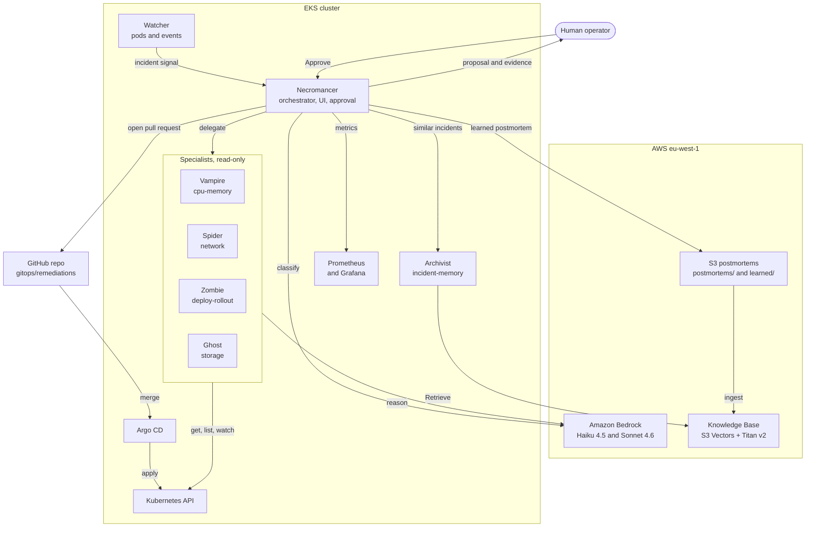

# Kiroween Incident Crypt 👻

A crew of read-only AI agents that watches an Amazon EKS cluster, diagnoses what breaks,
remembers what broke before, and proposes a fix as a **pull request that a human has to
approve**. Built with [Kiro](https://kiro.dev) for the Kiroween 2026 hackathon
(category: Frankenstein).

When a pod is OOM-killed, an image will not pull, a volume will not bind or a NetworkPolicy
cuts a service off, the crew:

1. notices it (a watcher on pods and events),
2. classifies it and hands it to the right specialist,
3. checks what the cluster actually says (read-only), and shows its evidence,
4. looks up similar past incidents in a knowledge base of postmortems,
5. proposes one validated change and waits,
6. on **Approve** in the web UI, opens a real GitHub pull request against `gitops/`,
7. writes the approved incident back as a postmortem, so it can be found next time.

Nothing changes the cluster except a merged pull request that Argo CD applies. The agents
cannot write to Kubernetes at all.

> **Status, 18 Nov 2026.** Running on a real cluster in `eu-west-1`. The full loop has run end
> to end once, for a broken NetworkPolicy: approval, pull request
> [#2](https://github.com/romanceresnak/kiroween-incident-crypt/pull/2) (merged), a learned
> postmortem in S3 and a finished knowledge-base ingestion. That the learned postmortem is then
> *found* by a second incident has not been recorded yet. See
> [What is not verified](#known-trade-offs-and-what-is-not-verified).

## The crew

| Agent | Spooky name | What it does | Model |
|---|---|---|---|
| `orchestrator` | **Necromancer** | Classifies each incident, asks the Archivist for similar ones, delegates to a specialist, correlates incidents with one root cause, serves the UI and the approval API, opens the pull request. | Claude Haiku 4.5 (classification only) |
| `cpu-memory` | **Vampire** | OOM kills, CPU throttling, limits and requests, HPA. | Claude Sonnet 4.6 |
| `network` | **Spider** | NetworkPolicies, DNS, Services and endpoints. | Claude Sonnet 4.6 |
| `deploy-rollout` | **Zombie** | Image pulls, bad config, stuck rollouts, Argo CD sync. | Claude Sonnet 4.6 |
| `storage` | **Ghost** | PVCs, mounts, the EBS CSI driver. | Claude Sonnet 4.6 |
| `incident-memory` | **Archivist** | Retrieves similar postmortems from a Bedrock Knowledge Base. Calls no model. | none (retrieval only) |

A **watcher** (the `orchestrator-watcher` Deployment, same image as the orchestrator) streams
pods and events and submits incidents. Models are EU inference profiles
(`eu.anthropic.claude-haiku-4-5-20251001-v1:0`, `eu.anthropic.claude-sonnet-4-6`). Agents are
[Strands Agents](https://strandsagents.com) in Python 3.12; the specialists run as tools of the
orchestrator, and agents never call each other directly.

## Architecture



Terraform builds the VPC, EKS (Kubernetes 1.37, Spot nodes), ECR, the Knowledge Base, one
Pod Identity role per agent and the GitHub OIDC roles. Argo CD deploys the agents Helm chart,
metrics-server and kube-prometheus-stack from `gitops/apps`. GitHub Actions tests, builds and
pushes the six images with commit-SHA tags, then commits the tags to the chart.

## The flow

1. **Watcher.** Two threads stream pods and events. Signals: `OOMKilled`; waiting states
   (`ImagePullBackOff`, `ErrImagePull`, `CrashLoopBackOff`, `CreateContainerConfigError`);
   events (`FailedScheduling`, `FailedMount`, `FailedAttachVolume`, `Unhealthy`, PVC
   `ProvisioningFailed`). An `Unhealthy` event waits a 60 s grace period and is checked again
   30 s later, so slow starts are not reported. One incident per workload per 600 s. The
   namespaces `kube-system`, `kube-node-lease`, `argocd`, `agents` and `monitoring` are not
   watched.
2. **Classify.** Haiku returns `cpu_memory`, `network`, `deploy_rollout`, `storage` or
   `unknown`. Low confidence, or a category that contradicts the signal, becomes `unknown` and
   no specialist runs.
3. **Specialist.** The chosen agent calls read-only tools (pod, events, logs, metrics, quotas,
   NetworkPolicies, PVCs and so on) and returns a diagnosis, the evidence (tool, field, value)
   and an `outcome`: `action_required`, `transient` (it recovered by itself) or `no_action`.
   Incidents in one namespace that share a workload or dependency within 300 s are correlated
   to the first one instead of investigated again.
4. **Similar incidents.** The Archivist retrieves postmortems from the Knowledge Base, filtered
   by category, scored at least 0.5, one hit per document. The result is shown in the UI and
   handed to the specialist as context. Each hit says whether it is a `seeded` or a `learned`
   postmortem.
5. **Proposal.** At most one change, always `requires_approval: true`. The model proposes; code
   decides whether it is acceptable (allowed fields, protected namespaces). Transient and
   no-action outcomes carry no proposal.
6. **Human approval.** The incident waits as `awaiting_approval`. A person reads the evidence
   and clicks Approve or Reject in `/ui`.
7. **Real pull request.** Approve renders a Kustomize patch,
   `gitops/remediations/<namespace>/<kind>-<name>.yaml`, and opens a pull request through the
   GitHub API. Without a token, every approval is a dry run.
8. **Learned postmortem.** The approved incident is written to
   `learned/<incident-id>.md` (with a metadata sidecar) in the postmortem bucket, and an
   ingestion job re-indexes the Knowledge Base. The document says "approved change, not yet
   confirmed to work".
9. **Found next time.** The next similar incident can retrieve it as a similar incident with
   `source: learned`.

A real example of steps 1 to 8 is pull request
[#2](https://github.com/romanceresnak/kiroween-incident-crypt/pull/2): the crew found that a
NetworkPolicy allowed `app: netpol-trusted` while the blocked client was `app: netpol-client`,
and proposed the patch in
[`gitops/remediations/chaos-netpol/networkpolicy-allow-trusted.yaml`](gitops/remediations/chaos-netpol/networkpolicy-allow-trusted.yaml).

## Security model

| Control | What it means | Where |
|---|---|---|
| Read-only agents | RBAC verbs are `get`, `list`, `watch` only; no secrets, no wildcards. A test walks the source and fails on any write-style Kubernetes call. | `gitops/charts/agents`, `agents/shared` tests |
| Human approval | Every proposal has `requires_approval: true`. Approve and Reject act only on an incident that is `awaiting_approval`, accept only same-origin JSON, and nothing else changes the cluster. | `agents/orchestrator` |
| Pull-request remediation | The only way a change reaches the cluster is a merged pull request that Argo CD applies. Git history is the audit trail and the rollback. | `gitops/remediations/` |
| Proposals checked by code | Allowed fields, protected namespaces and value shapes are validated outside the model. | `agents/shared` |
| Untrusted tool output | Logs, events and annotations are wrapped in `<tool_data>` and treated as data. | `agents/shared` |
| Least-privilege IAM | One EKS Pod Identity role per agent, trusted only for its cluster, namespace and service account. Bedrock invoke is limited to `eu.*` inference profiles. The orchestrator can write `learned/*` and start one ingestion job, nothing else (checked with the IAM policy simulator, 10 of 10). | `infra/modules/pod_identity`, `scripts/verify-learning-iam.sh` |
| Immutable OIDC subjects | CI roles trust `repo:<owner>@<id>/<repo>@<id>`, which a renamed or recreated repository cannot reuse. | `infra`, `gha_oidc_subject_prefix` |
| CI hygiene | Actions pinned to full SHAs; ECR tags immutable and equal to commit SHAs; the push role is limited to `kiroween/*`. | `.github/workflows` |
| NetworkPolicies | Default deny both ways. Specialists and the Archivist accept traffic only from the orchestrator; the orchestrator only from the watcher; metrics only from `monitoring`. Egress: DNS, 443 and the Pod Identity Agent. | `gitops/charts/agents` |
| Hardened pods | Non-root (10001), read-only root filesystem, all capabilities dropped, seccomp `RuntimeDefault`, no static AWS credentials. | `gitops/charts/agents` |
| UI | Same-origin scripts and styles only (CSP), `textContent` only, no `innerHTML`. Reachable only by `kubectl port-forward`, never through an ingress. | `agents/orchestrator/.../ui` |

## What an incident costs

Measured from one real incident, not an average. Grafana was OOM-killed on this cluster and the
`cpu-memory` agent investigated it
([`docs/demo-results/grafana-oom-real.json`](docs/demo-results/grafana-oom-real.json)):

| Agent | Input tokens | Output tokens | Cost |
|---|---:|---:|---:|
| Necromancer (Haiku 4.5) | 2,988 | 236 | $0.0046 |
| Vampire (Sonnet 4.6) | 22,235 | 1,966 | $0.1058 |
| **Total** | 25,223 | 2,202 | **$0.1104** |

From submission to "awaiting approval" took about 21 seconds (`created_at` to `updated_at`).
Cost is tokens times the prices in `gitops/charts/agents/values.yaml` (USD per million tokens:
Haiku 1.10 in and 5.50 out, Sonnet 3.30 in and 16.50 out). Those prices were typed in by hand
and have not been checked against the AWS price list. The incident predates the Archivist, so
it carries no retrieval step. Other incidents will differ: a longer investigation costs more.

The cost is exported as Prometheus metrics labelled by agent and incident, and shown in the
Grafana dashboard "Kiroween Incident Crypt". The AWS Budget defaults to 120 USD a month.

## Quickstart

You need an AWS account with Bedrock model access for the EU inference profiles above,
Terraform, `kubectl`, the AWS CLI, [uv](https://docs.astral.sh/uv/), and a fork or copy of this
repository (the Argo CD applications point at `romanceresnak/kiroween-incident-crypt`; change
`repoURL` in `gitops/apps` and `github.repository` in the chart values for your own).

1. **State bucket.** In `infra/bootstrap`, `terraform init && terraform apply`.
2. **Stack.** In `infra`:
   ```bash
   terraform init -backend-config=bucket=kiroween-prod-tf-state-<account_id>
   export TF_VAR_admin_iam_principal_arn=arn:aws:iam::<account_id>:role/<admin-role>
   export TF_VAR_budget_alert_email=<you@example.com>
   # Immutable subject for your repository; the default is this repository's.
   export TF_VAR_gha_oidc_subject_prefix="$(gh api repos/<owner>/<repo>/actions/oidc/customization/sub --jq .sub_claim_prefix)"
   terraform plan
   terraform apply -target=module.vpc -target=module.eks -target=module.github_oidc
   terraform apply
   ```
   Read the plan before each apply. `infra/README.md` lists every variable.
3. **kubectl.** `aws eks update-kubeconfig --name kiroween-prod --region eu-west-1`
4. **CI.** Set the repository variable `ECR_PUSH_ROLE_ARN` to `terraform output -raw gha_ecr_push_role_arn`
   and push to `main`. The workflow runs the tests, pushes six images and commits their tags to
   the chart. Argo CD syncs `gitops/apps` and deploys the agents, metrics-server and monitoring.
5. **Secrets** (the chart never creates them):
   ```bash
   kubectl -n monitoring create secret generic grafana-admin \
     --from-literal=admin-user=admin --from-literal=admin-password='<choose one>'
   # Optional. Without it every approval is a dry run. Use a fine-grained token limited to this
   # repository with Contents and Pull requests write access.
   kubectl -n agents create secret generic orchestrator-github --from-literal=token='<token>'
   ```
6. **Postmortems.** `scripts/sync-postmortems.sh` uploads the eight seeded postmortems and
   re-indexes the Knowledge Base. Set `incidentMemory.knowledgeBaseId` and
   `orchestrator.learning.dataSourceId` in `gitops/charts/agents/values.yaml` (the command to
   read the data source ID is in the comment above it).
7. **Open it.**
   ```bash
   kubectl -n agents port-forward svc/orchestrator 8080:8080      # http://localhost:8080/ui/
   kubectl -n monitoring port-forward svc/monitoring-grafana 3000:80
   ```

## Demo

Each scenario lives in `chaos/<name>/<name>.sh up|down` and refuses to run unless `kubectl`
points at the cluster `kiroween-prod`. Run `down` afterwards.

| Scenario | What it breaks | Specialist | Result so far |
|---|---|---|---|
| `chaos/oom` | A container that exceeds its memory limit | Vampire | Not recorded in the repository. |
| `chaos/netpol` | A NetworkPolicy lets only `app: netpol-trusted` reach the server; the client is `app: netpol-client` | Spider | Carried through approval to merged pull request [#2](https://github.com/romanceresnak/kiroween-incident-crypt/pull/2): `spec.ingress[0].from[0].podSelector.matchLabels.app` from `netpol-trusted` to `netpol-client`. |
| `chaos/badimage` | A Deployment updated to an image tag that does not exist (revision 1 still works) | Zombie | Ran live on 17 Nov, before the watcher changes; not re-run since. |
| `chaos/pvc` | A PVC that names a missing StorageClass, and a Deployment that mounts it | Ghost | Ran live on 17 Nov, before the watcher changes; not re-run since. |

For `netpol`, the `Unhealthy` event appears about 60 to 70 seconds after `up`. Then open the
UI, read the evidence, click Approve and open the pull request. The step-by-step recording
plan, with timings, is in [`docs/DEMO-SCRIPT.md`](docs/DEMO-SCRIPT.md).

To submit an incident by hand, `POST /incidents` through the port-forward. The watcher does not
watch `monitoring`, so this is how the Grafana case above was investigated:

```bash
curl -s -X POST localhost:8080/incidents -H 'content-type: application/json' -d '{
  "incident_id": "manual-grafana-1", "source": "manual", "reason": "OOMKilled",
  "namespace": "monitoring", "workload": {"kind": "Deployment", "name": "monitoring-grafana"},
  "pod": "<pod name>", "container": "grafana",
  "message": "Container grafana terminated: OOMKilled (exit code 137)",
  "observed_at": "2026-11-18T09:00:00Z"}'
```

## Development

```bash
cd agents/<package> && uv sync --frozen && uv run --frozen ruff check . && uv run --frozen pytest -q
uv run --frozen --project agents/shared pytest -q gitops chaos tools scripts
helm lint gitops/charts/agents
cd tools/ui-tests && npm ci --ignore-scripts && npm test      # jsdom tests of the UI
```

CI (`.github/workflows/agents-images.yml`) runs the same commands. Five Kiro hooks in
`.kiro/hooks/` run them for the file you save; see [`docs/KIRO-WRITEUP.md`](docs/KIRO-WRITEUP.md).
The design lives in `.kiro/specs/` (seven specs: requirements, design, tasks) and the project's
rules in `.kiro/steering/`.

## Teardown

```bash
chaos/netpol/netpol.sh down    # and oom, badimage, pvc
```

Then, in `infra`: delete the Argo CD root application first so it stops recreating things, then
`terraform destroy`. The postmortem bucket is created with `force_destroy`, so its contents go
too. The state bucket in `infra/bootstrap` has `prevent_destroy` and is removed by hand.
`terraform destroy` has not been run for this project. Check the plan, and check the AWS
console for leftovers (EBS volumes created by PVCs, load balancers, ECR images).

## Known trade-offs and what is not verified

Chosen on purpose:
- The approval endpoints have no login. Access is `kubectl port-forward`, so whoever can
  forward the port can approve. The UI is not exposed publicly for this reason.
- The incident store, the correlation state and pending `Unhealthy` re-checks are in memory.
  A restart of the orchestrator loses them.
- Prometheus keeps two days of data on `emptyDir`. Nodes are Spot.
- The GitHub Actions apply role can change its own permissions (`infra/README.md`).
- The agents recommend; they do not verify that a fix worked.

Not verified:
- A second incident that finds the **learned** postmortem as a similar incident.
- The `badimage` and `pvc` scenarios after the latest watcher changes, and the `gp2` fix for
  `pvc` on Kubernetes 1.37.
- The minimum similarity score (0.5) is a first guess; scores seen ranged from 0.64 to 0.73,
  and an unrelated postmortem once scored just above the right one.
- Model prices (see above) and the cost of anything but the one incident shown.
- Whether the "ingestion already running" case is the error the code expects.
- Poisoning: a learned postmortem records an *approved proposal*, which is not proof that it
  worked, and text from the cluster ends up in it. Both are limited (the text is bounded, only
  approved incidents are stored, and the document says so) but not eliminated.
- The Kiro hooks have been run by hand and tested against fake tools, not inside the Kiro IDE.

## Repository layout

```
agents/       one Python package per agent, plus shared/
infra/        Terraform: VPC, EKS, ECR, Knowledge Base, Pod Identity, GitHub OIDC, budget
gitops/       Argo CD applications, the agents Helm chart, remediations merged by pull request
chaos/        scenarios that break a cluster on purpose
docs/         postmortems (seeded), demo results, and the hackathon write-ups
tools/        tests for CI, the image-tag tool and the UI DOM tests
scripts/      operator scripts (postmortem sync, IAM check, Kiro hook runner)
.kiro/        specs, steering, MCP settings and hooks
```

## License

[MIT](LICENSE) © 2026 Roman Ceresnak
