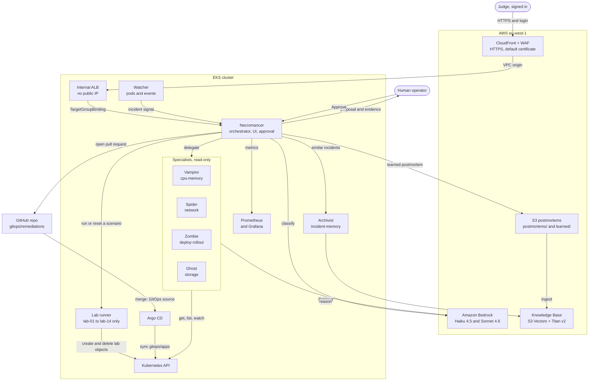

# Kiroween Incident Crypt 👻

A crew of read-only AI agents that watches an Amazon EKS cluster, diagnoses what breaks,
remembers what broke before, and proposes a fix as a **pull request that a human has to
approve**. Built with [Kiro](https://kiro.dev) for the Kiroween 2026 hackathon
(category: Frankenstein).

When a pod is OOM-killed, an image will not pull, a volume will not bind or a NetworkPolicy
cuts a service off, the crew:

1. notices it (a watcher on pods and events),
2. classifies it and hands it to the right specialist,
3. checks what the cluster actually says (read-only), and shows its evidence,
4. looks up similar past incidents in a knowledge base of postmortems,
5. proposes one validated change and waits,
6. on **Approve** in the web UI, opens a real GitHub pull request against `gitops/`,
7. writes the approved incident back as a postmortem, so it can be found next time.

The agents cannot write to Kubernetes at all. Their only output is a proposal, and an approved
proposal becomes a pull request. Applying it is a separate step that is **not automated yet**:
see [Approved changes are not applied](#known-trade-offs-and-what-is-not-verified).

> **Try it.** The live system, behind a login: <https://d3uh8kq3w5msy5.cloudfront.net> (the credentials are in the Devpost
> judges-only field). There, the [Scenario Lab](#scenario-lab) breaks the real cluster on
> purpose, 14 ways, and the crew investigates. No login needed: a read-only
> [replay](https://romanceresnak.github.io/kiroween-incident-crypt/) of the real UI, built from the saved records of real runs, with Approve and
> Reject disabled (see [Replay](#replay)).
>
> **Status, 18 Nov 2026.** Running on a real cluster in `eu-west-1`. The full loop has run
> twice, for the same broken NetworkPolicy. Run 1: approval, pull request
> [#2](https://github.com/romanceresnak/kiroween-incident-crypt/pull/2) (merged), a learned
> postmortem in S3 and a knowledge-base ingestion. Run 2, 14 minutes later: the learned
> postmortem from run 1 came back as the **top similar incident** (score 0.846; the seeded
> postmortems scored 0.708 and 0.683), followed by approval, pull request
> [#3](https://github.com/romanceresnak/kiroween-incident-crypt/pull/3) and a second learned
> postmortem. Merging a pull request did not change the cluster. Records:
> [`docs/demo-results`](docs/demo-results/). See
> [What is not verified](#known-trade-offs-and-what-is-not-verified).

## The crew

| Agent | Spooky name | What it does | Model |
|---|---|---|---|
| `orchestrator` | **Necromancer** | Classifies each incident, asks the Archivist for similar ones, delegates to a specialist, correlates incidents with one root cause, serves the UI and the approval API, opens the pull request. | Claude Haiku 4.5 (classification only) |
| `cpu-memory` | **Vampire** | OOM kills, CPU throttling, limits and requests, HPA. | Claude Sonnet 4.6 |
| `network` | **Spider** | NetworkPolicies, DNS, Services and endpoints. | Claude Sonnet 4.6 |
| `deploy-rollout` | **Zombie** | Image pulls, bad config, stuck rollouts, Argo CD sync. | Claude Sonnet 4.6 |
| `storage` | **Ghost** | PVCs, mounts, the EBS CSI driver. | Claude Sonnet 4.6 |
| `incident-memory` | **Archivist** | Retrieves similar postmortems from a Bedrock Knowledge Base. Calls no model. | none (retrieval only) |

A **watcher** (the `orchestrator-watcher` Deployment, same image as the orchestrator) streams
pods and events and submits incidents. Models are EU inference profiles
(`eu.anthropic.claude-haiku-4-5-20251001-v1:0`, `eu.anthropic.claude-sonnet-4-6`). Agents are
[Strands Agents](https://strandsagents.com) in Python 3.12; the specialists run as tools of the
orchestrator, and agents never call each other directly.

## Architecture



Terraform builds the VPC, EKS (Kubernetes 1.37, Spot nodes), ECR, the Knowledge Base, one
Pod Identity role per agent, the GitHub OIDC roles, and the public path: an internal ALB, a
CloudFront distribution reaching it through a VPC origin, and a WAF. Argo CD deploys the agents Helm chart,
metrics-server and kube-prometheus-stack from `gitops/apps`. GitHub Actions tests, builds and
pushes the six images with commit-SHA tags, then commits the tags to the chart.

## The flow

1. **Watcher.** Two threads stream pods and events. Signals: `OOMKilled`; waiting states
   (`ImagePullBackOff`, `ErrImagePull`, `CrashLoopBackOff`, `CreateContainerConfigError`);
   events (`FailedScheduling`, `FailedMount`, `FailedAttachVolume`, `Unhealthy`, PVC
   `ProvisioningFailed`). An `Unhealthy` event waits a 60 s grace period and is checked again
   30 s later, so slow starts are not reported. One incident per workload per 600 s. The
   namespaces `kube-system`, `kube-node-lease`, `argocd`, `agents` and `monitoring` are not
   watched.
2. **Classify.** Haiku returns `cpu_memory`, `network`, `deploy_rollout`, `storage` or
   `unknown`. Low confidence, or a category that contradicts the signal, becomes `unknown` and
   no specialist runs.
3. **Specialist.** The chosen agent calls read-only tools (pod, events, logs, metrics, quotas,
   NetworkPolicies, PVCs and so on) and returns a diagnosis, the evidence (tool, field, value)
   and an `outcome`: `action_required`, `transient` (it recovered by itself) or `no_action`.
   Incidents in one namespace that share a workload or dependency within 300 s are correlated
   to the first one instead of investigated again.
4. **Similar incidents.** The Archivist retrieves postmortems from the Knowledge Base, filtered
   by category, scored at least 0.5, one hit per document. The result is shown in the UI and
   handed to the specialist as context. Each hit says whether it is a `seeded` or a `learned`
   postmortem.
5. **Proposal.** At most one change, always `requires_approval: true`. The model proposes; code
   decides whether it is acceptable (allowed fields, protected namespaces). Transient and
   no-action outcomes carry no proposal.
6. **Human approval.** The incident waits as `awaiting_approval`. A person reads the evidence
   and clicks Approve or Reject in `/ui`.
7. **Real pull request.** Approve renders a Kustomize patch,
   `gitops/remediations/<namespace>/<kind>-<name>.yaml`, and opens a pull request through the
   GitHub API. Without a token, every approval is a dry run. Merging records the approved
   change; no Argo CD Application applies `gitops/remediations/` yet.
8. **Learned postmortem.** The approved incident is written to
   `learned/<incident-id>.md` (with a metadata sidecar) in the postmortem bucket, and an
   ingestion job re-indexes the Knowledge Base. The document says "approved change, not yet
   confirmed to work".
9. **Found next time.** The next similar incident retrieves it as a similar incident with
   `origin: learned`. Observed once: in run 2 above, the postmortem written after run 1 was the
   top hit.

A real example of steps 1 to 8 is pull request
[#2](https://github.com/romanceresnak/kiroween-incident-crypt/pull/2): the crew found that a
NetworkPolicy allowed `app: netpol-trusted` while the blocked client was `app: netpol-client`,
and proposed the patch in
[`gitops/remediations/chaos-netpol/networkpolicy-allow-trusted.yaml`](gitops/remediations/chaos-netpol/networkpolicy-allow-trusted.yaml).

## Security model

| Control | What it means | Where |
|---|---|---|
| Read-only agents | RBAC verbs are `get`, `list`, `watch` only; no secrets, no wildcards. A test walks the source and fails on any write-style Kubernetes call. | `gitops/charts/agents`, `agents/shared` tests |
| Human approval | Every proposal has `requires_approval: true`. Approve and Reject act only on an incident that is `awaiting_approval`, accept only same-origin JSON, and nothing else changes the cluster. | `agents/orchestrator` |
| Pull-request remediation | An approved change is a pull request, never a write to the cluster, so git history is the audit trail. Today merging it records the change and does not apply it (see trade-offs). | `gitops/remediations/` |
| Proposals checked by code | Allowed fields, protected namespaces and value shapes are validated outside the model. | `agents/shared` |
| Untrusted tool output | Logs, events and annotations are wrapped in `<tool_data>` and treated as data. | `agents/shared` |
| Least-privilege IAM | One EKS Pod Identity role per agent, trusted only for its cluster, namespace and service account. Bedrock invoke is limited to `eu.*` inference profiles. The orchestrator can write `learned/*` and start one ingestion job, nothing else (checked with the IAM policy simulator, 10 of 10). | `infra/modules/pod_identity`, `scripts/verify-learning-iam.sh` |
| Immutable OIDC subjects | CI roles trust `repo:<owner>@<id>/<repo>@<id>`, which a renamed or recreated repository cannot reuse. | `infra`, `gha_oidc_subject_prefix` |
| CI hygiene | Actions pinned to full SHAs; ECR tags immutable and equal to commit SHAs; the push role is limited to `kiroween/*`. | `.github/workflows` |
| NetworkPolicies | Default deny both ways. Specialists and the Archivist accept traffic only from the orchestrator; the orchestrator only from the watcher; metrics only from `monitoring`. Egress: DNS, 443 and the Pod Identity Agent. | `gitops/charts/agents` |
| Hardened pods | Non-root (10001), read-only root filesystem, all capabilities dropped, seccomp `RuntimeDefault`, no static AWS credentials. | `gitops/charts/agents` |
| UI | Same-origin scripts and styles only (CSP), `textContent` only, no `innerHTML`. | `agents/orchestrator/.../ui` |
| Public access | CloudFront (HTTPS only, default certificate) reaches an **internal** ALB through a VPC origin: no public load balancer, no public IP. The ALB accepts only the VPC origin's security group. A WAF rate-limits an IP to 300 requests per 5 minutes and runs the AWS common rule set. | `infra/modules/public_access` |
| Login | Every route except the health probes needs a session. One account from a Secret you create; constant-time comparison of both fields; an `HttpOnly`, `Secure`, `SameSite=Strict` cookie; five failures lock an address for 15 minutes; the address is the one the trusted proxies appended. The watcher uses a separate token, accepted only for `POST /incidents`. | `agents/orchestrator/.../auth.py` |
| The judge can decide only lab incidents | The signed-in account may approve, reject and submit incidents in `lab-01` to `lab-14` only, so it cannot open a pull request for a real incident. | `agents/orchestrator/.../api.py` |
| The only writer | The lab runner is the one workload that may create or delete anything, and only in the 14 lab namespaces, by a RoleBinding in each. The orchestrator and every agent stay read-only. A test derives the role from the calls in the code. | `gitops/charts/agents/templates/lab.yaml` |

## What an incident costs

Measured from one real incident, not an average. Grafana was OOM-killed on this cluster and the
`cpu-memory` agent investigated it
([`docs/demo-results/grafana-oom-real.json`](docs/demo-results/grafana-oom-real.json)):

| Agent | Input tokens | Output tokens | Cost |
|---|---:|---:|---:|
| Necromancer (Haiku 4.5) | 2,988 | 236 | $0.0046 |
| Vampire (Sonnet 4.6) | 22,235 | 1,966 | $0.1058 |
| **Total** | 25,223 | 2,202 | **$0.1104** |

From submission to "awaiting approval" took about 21 seconds (`created_at` to `updated_at`).
Cost is tokens times the prices in `gitops/charts/agents/values.yaml` (USD per million tokens:
Haiku 1.10 in and 5.50 out, Sonnet 3.30 in and 16.50 out). Those prices were typed in by hand
and have not been checked against the AWS price list. The incident predates the Archivist, so
it carries no retrieval step. Other incidents will differ: a longer investigation costs more.

Five real incidents so far, from the saved records in
[`docs/demo-results`](docs/demo-results/):

| Incident | Specialist | Input tokens | Output tokens | Cost |
|---|---|---:|---:|---:|
| Grafana OOM (submitted by hand) | cpu-memory | 25,223 | 2,202 | $0.1104 |
| NetworkPolicy, run 1 | network | 19,883 | 1,536 | $0.0790 |
| NetworkPolicy, run 2 | network | 27,440 | 1,738 | $0.1052 |
| Bad image tag (`chaos/badimage`) | deploy-rollout | 14,199 | 1,679 | $0.0609 |
| Missing StorageClass (`chaos/pvc`) | storage | 12,753 | 1,243 | $0.0508 |

The cost is exported as Prometheus metrics labelled by agent and incident, and shown in the
Grafana dashboard "Kiroween Incident Crypt". The AWS Budget defaults to 120 USD a month.

## Quickstart

You need an AWS account with Bedrock model access for the EU inference profiles above,
Terraform, `kubectl`, the AWS CLI, [uv](https://docs.astral.sh/uv/), and a fork or copy of this
repository (the Argo CD applications point at `romanceresnak/kiroween-incident-crypt`; change
`repoURL` in `gitops/apps` and `github.repository` in the chart values for your own).

1. **State bucket.** In `infra/bootstrap`, `terraform init && terraform apply`.
2. **Stack.** In `infra`:
   ```bash
   terraform init -backend-config=bucket=kiroween-prod-tf-state-<account_id>
   export TF_VAR_admin_iam_principal_arn=arn:aws:iam::<account_id>:role/<admin-role>
   export TF_VAR_budget_alert_email=<you@example.com>
   # Immutable subject for your repository; the default is this repository's.
   export TF_VAR_gha_oidc_subject_prefix="$(gh api repos/<owner>/<repo>/actions/oidc/customization/sub --jq .sub_claim_prefix)"
   terraform plan
   terraform apply -target=module.vpc -target=module.eks -target=module.github_oidc
   terraform apply
   ```
   Read the plan before each apply. `infra/README.md` lists every variable.
3. **kubectl.** `aws eks update-kubeconfig --name kiroween-prod --region eu-west-1`
4. **CI.** Set the repository variable `ECR_PUSH_ROLE_ARN` to `terraform output -raw gha_ecr_push_role_arn`
   and push to `main`. The workflow runs the tests, pushes six images and commits their tags to
   the chart. Argo CD syncs `gitops/apps` and deploys the agents, metrics-server and monitoring.
5. **Secrets** (the chart never creates them):
   ```bash
   kubectl -n monitoring create secret generic grafana-admin \
     --from-literal=admin-user=admin --from-literal=admin-password='<choose one>'
   # Optional. Without it every approval is a dry run. Use a fine-grained token limited to this
   # repository with Contents and Pull requests write access.
   kubectl -n agents create secret generic orchestrator-github --from-literal=token='<token>'
   # The login for the UI and the API. Without it every route but the health probes answers 503.
   kubectl -n agents create secret generic orchestrator-auth \
     --from-literal=username='<judge>' --from-literal=password='<a long password>' \
     --from-literal=internal-token="$(openssl rand -hex 32)"
   ```
6. **Postmortems.** `scripts/sync-postmortems.sh` uploads the eight seeded postmortems and
   re-indexes the Knowledge Base. Set `incidentMemory.knowledgeBaseId` and
   `orchestrator.learning.dataSourceId` in `gitops/charts/agents/values.yaml` (the command to
   read the data source ID is in the comment above it).
7. **Open it.** The address is the Terraform output `public_url` (sign in with the account from
   `orchestrator-auth`), or by port-forward:
   ```bash
   kubectl -n agents port-forward svc/orchestrator 8080:8080      # http://localhost:8080/ui/
   kubectl -n monitoring port-forward svc/monitoring-grafana 3000:80
   ```

## Demo

Each scenario lives in `chaos/<name>/<name>.sh up|down` and refuses to run unless `kubectl`
points at the cluster `kiroween-prod`. Run `down` afterwards.

| Scenario | What it breaks | Specialist | Result so far |
|---|---|---|---|
| `chaos/oom` | A container that exceeds its memory limit | Vampire | Not recorded in the repository. |
| `chaos/netpol` | A NetworkPolicy lets only `app: netpol-trusted` reach the server; the client is `app: netpol-client` | Spider | Carried through approval twice. Both proposed `spec.ingress[0].from[0].podSelector.matchLabels.app` from `netpol-trusted` to `netpol-client`: pull request [#2](https://github.com/romanceresnak/kiroween-incident-crypt/pull/2) (merged) and [#3](https://github.com/romanceresnak/kiroween-incident-crypt/pull/3). In run 2 the learned postmortem from run 1 was the top similar incident. |
| `chaos/badimage` | A Deployment updated to an image tag that does not exist (revision 1 still works) | Zombie | Re-run on 18 Nov after the hardening changes: classified `deploy_rollout` (high), 7 pieces of evidence, `awaiting_approval` 15 s after detection. It proposed the image `python:3.12-slim`, the revision that worked, and the second signal (`ImagePullBackOff`) was correlated to it. Not approved. |
| `chaos/pvc` | A PVC that names a missing StorageClass, and a Deployment that mounts it | Ghost | Re-run on 18 Nov after the hardening changes: classified `storage` (high), 6 pieces of evidence, `awaiting_approval` 11 s after detection. It proposed `storageClassName` `gp2`, the only StorageClass in the cluster; the `FailedScheduling` signal was correlated to it. Not approved. |

For `netpol`, the `Unhealthy` event appears about 60 to 70 seconds after `up`. Then open the
UI, read the evidence, click Approve and open the pull request. The step-by-step recording
plan, with timings, is in [`docs/DEMO-SCRIPT.md`](docs/DEMO-SCRIPT.md).

To submit an incident by hand, `POST /incidents` through the port-forward, with the internal
token from the Secret `orchestrator-auth` as a bearer token (the Grafana case above was run
before the login existed, without it). The watcher does not watch `monitoring`, so this is how
that case was investigated:

```bash
TOKEN=$(kubectl -n agents get secret orchestrator-auth -o jsonpath='{.data.internal-token}' | base64 -d)
curl -s -X POST localhost:8080/incidents -H "authorization: Bearer $TOKEN" \
  -H 'content-type: application/json' -d '{
  "incident_id": "manual-grafana-1", "source": "manual", "reason": "OOMKilled",
  "namespace": "monitoring", "workload": {"kind": "Deployment", "name": "monitoring-grafana"},
  "pod": "<pod name>", "container": "grafana",
  "message": "Container grafana terminated: OOMKilled (exit code 137)",
  "observed_at": "2026-11-18T09:00:00Z"}'
```

## Scenario Lab

A judge, or anyone with the login, can break the real cluster on purpose and watch the crew
investigate. Open <https://d3uh8kq3w5msy5.cloudfront.net>, sign in, choose **Scenario Lab**, pick a card and press **Run**.
The lab applies a small failing workload in its own namespace, the watcher notices, and the
page links to the incident the run produced: read the evidence, the similar past incidents and
the proposal. If the crew proposes a fix you can press **Approve**; that opens a pull request
on the sandbox branch `lab-remediations`, never on `main`, and nothing is applied to the
cluster and nothing is saved as memory. Press **Reset** to clean up at once.

Limits: one scenario at a time, ten runs an hour, cleaned up by itself after 15 minutes.

**Experimental.** `rollout-stuck-readiness` (lab-11, "An update that never becomes ready") has an
Experimental badge on its card and a line saying the crew does not yet answer it reliably. It
still runs. In the replay of its saved incident the classifier reached the right specialist in 1
of 10 runs ([`routing-cpu-hint.txt`](docs/demo-results/lab/routing-cpu-hint.txt)). To see the
crew at its best, try the other 13.

The 14 scenarios, **as measured on the live cluster on 18 Nov 2026** (one run each, before this
change was deployed; records in [`docs/demo-results/lab`](docs/demo-results/lab/)):

| Namespace | Scenario | What breaks | Answered by | Result | To incident | To decision | Cost |
|---|---|---|---|---|---:|---:|---:|
| `lab-01` | `oom-killed` | A container eats all its memory | Vampire | a fix to approve: `resources.limits.memory` | 11 s | 18 s | $0.08 |
| `lab-02` | `cpu-throttling` | A busy server starved of CPU | **Spider** (card says Vampire) | a diagnosis only | 74 s | 19 s | $0.09 |
| `lab-03` | `memory-leak` | A slow memory leak | Vampire | a fix to approve: `resources.limits.memory` | 51 s | 18 s | $0.08 |
| `lab-04` | `netpol-blocks-client` | A firewall rule blocks the client | Spider | a fix to approve: `spec.ingress[0].from[0].podSelector.matchLabels.app` | 71 s | 26 s | $0.08 |
| `lab-05` | `service-selector-mismatch` | A Service that points at nothing | Spider | a fix to approve: `spec.selector.app` | 69 s | 13 s | $0.08 |
| `lab-06` | `wrong-target-port` | A Service sends traffic to the wrong port | Spider | a fix to approve: `spec.ports[0].targetPort` | 68 s | 17 s | $0.11 |
| `lab-07` | `dns-missing-service` | A client calls a Service that does not exist | Spider | a diagnosis only | 70 s | 20 s | $0.10 |
| `lab-08` | `bad-image-tag` | A rollout with an image that does not exist | Zombie | a fix to approve: `spec.template.spec.containers[name=web].image` | 21 s | 16 s | $0.06 |
| `lab-09` | `crashloop-missing-config-key` | A program that cannot find its settings | Zombie | a diagnosis only | 11 s | 26 s | $0.16 |
| `lab-10` | `missing-secret` | A container that needs a Secret that is not there | Zombie | a diagnosis only | 6 s | 20 s | $0.09 |
| `lab-11` | `rollout-stuck-readiness` | An update that never becomes ready | **Spider** (card says Zombie) | a diagnosis only | 86 s | 18 s | $0.09 |
| `lab-12` | `pvc-missing-storageclass` | A disk request for a storage type that does not exist | Ghost | a fix to approve: `spec.storageClassName` | 3 s | 11 s | $0.05 |
| `lab-13` | `rwx-on-ebs` | A shared disk that block storage cannot give | Ghost | a diagnosis only | 3 s | 18 s | $0.09 |
| `lab-14` | `missing-configmap-mount` | A pod that mounts a ConfigMap that is not there | Ghost | a diagnosis only | 3 s | 24 s | $0.10 |

All 14 produced an incident in their own namespace, and the whole run cost
$1.26. Twelve behaved as their card says. Two did not:
`cpu-throttling` and `rollout-stuck-readiness` were both sent to the Spider. The Spider
diagnosed both correctly (the 20m CPU limit; a `/ready` path that answers 404) but may not
propose a resource or probe change, so they ended as a diagnosis. The classifier sees one
event, and a failed health check looks the same whatever caused it. Three prompt wordings were
measured (36 of 42 each, [`routing.txt`](docs/demo-results/lab/routing.txt)); none helped, so
none was kept.

**Update, 19 Nov, for lab-02 only (the table above is the 18 Nov run and is unchanged).** Those
three wordings changed only the prompt, and the classifier still saw one event. The watcher now
also reads the failing container's CPU limit and request from the pod and its CPU usage from
metrics-server, and puts them on the incident, and the prompt says how to use them. Replaying
the 14 saved incidents through the real classifier with the usage **assumed** (lab-02 at its 20m
limit, every other probe container idle) sent lab-02 to the Vampire 10 of 10 times, and kept the
NetworkPolicy, DNS, Service and port scenarios with the Spider 10 of 10
([`routing-cpu-hint.txt`](docs/demo-results/lab/routing-cpu-hint.txt)). The CPU limit alone did
not help (0 of 3), so the result depends on metrics-server reporting that usage, which has not
been seen for a lab-02 pod. `rollout-stuck-readiness` is not fixed by this.

Seven scenarios end as a diagnosis because the crew cannot create a Secret or a
ConfigMap, or change what block storage can do.

How it is built: `lab/scenarios.py` holds the 14 fixed scenarios, `render.py` checks each
object before anything is applied (five kinds, images only from the public ECR mirror, explicit
limits, a locked-down pod, no Secret), and `runner.py` and `kube.py` are the runner. The
runner is the orchestrator image with another entrypoint. A request carries only a scenario id.
Every Deployment and claim gets a run suffix, so a second run is a new incident and not held
back by the watcher's cooldown. `tools/lab/run_scenarios.py` runs the scenarios on the cluster
and `tools/lab/measure_routing.py` replays the incidents through the classifier.

## Replay

<https://romanceresnak.github.io/kiroween-incident-crypt/> serves the real `/ui` in a replay mode, built by
`tools/replay/build.py` from the five incident records in
[`docs/demo-results`](docs/demo-results/) and deployed by the `replay-pages` GitHub Actions
workflow. The crew animates through each incident's stages, and Approve and Reject are shown
disabled with a link to the real pull request. It sends no request except a GET of those saved
files, and it has no secret and no AWS access. The stage timing is illustrative: the saved
records keep only two timestamps, and the page prints the recorded duration beside the stages.

Build it locally with `python3 tools/replay/build.py --out _site`.

## Development

```bash
cd agents/<package> && uv sync --frozen && uv run --frozen ruff check . && uv run --frozen pytest -q
uv run --frozen --project agents/shared pytest -q gitops chaos tools scripts
helm lint gitops/charts/agents
cd tools/ui-tests && npm ci --ignore-scripts && npm test      # jsdom tests of the UI
```

CI (`.github/workflows/agents-images.yml`) runs the same commands. Five Kiro hooks in
`.kiro/hooks/` run them for the file you save; see [`docs/KIRO-WRITEUP.md`](docs/KIRO-WRITEUP.md).
The design lives in `.kiro/specs/` (nine specs: requirements, design, tasks) and the project's
rules in `.kiro/steering/`.

## Teardown

```bash
chaos/netpol/netpol.sh down    # and oom, badimage, pvc
```

Then, in `infra`: delete the Argo CD root application first so it stops recreating things, then
`terraform destroy`. The postmortem bucket is created with `force_destroy`, so its contents go
too. The state bucket in `infra/bootstrap` has `prevent_destroy` and is removed by hand.
`terraform destroy` has not been run for this project. Check the plan, and check the AWS
console for leftovers (EBS volumes created by PVCs, load balancers, ECR images).

## Known trade-offs and what is not verified

Chosen on purpose, or not finished:
- **Approved changes are not applied.** The remediation files land in `gitops/remediations/`,
  which no Argo CD Application syncs. The chaos workloads are not managed by Argo CD, and
  applying a patch needs the workload's manifests to live in `gitops/`. So merged pull request
  [#2](https://github.com/romanceresnak/kiroween-incident-crypt/pull/2) records the approved
  NetworkPolicy change; it did not repair the policy in the cluster. The patch files have not
  been run through `kustomize build`.
- One shared account, and the credentials are given to the judges. The session, the lockout
  counters and the Lab's run count are in memory: a restart of the orchestrator signs everyone
  out and forgets them. The judge account can decide only lab incidents; the owner can lift
  that with `auth.labOnly`.
- The CloudFront address is `*.cloudfront.net` with the default certificate, no custom domain.
  CloudFront reaches the ALB over plain HTTP inside the VPC.
- A NetworkPolicy can only name the ALB by its two private subnets, which every pod also uses.
  The login is the control; the policy keeps the other pods and ports closed.
- The incident store, the correlation state and pending `Unhealthy` re-checks are in memory.
  A restart of the orchestrator loses them.
- Prometheus keeps two days of data on `emptyDir`. Nodes are Spot.
- The GitHub Actions apply role can change its own permissions (`infra/README.md`).
- The agents recommend; they do not verify that a fix worked.

Not verified:
- That the learned hit generalises. It was observed once, for the same scenario both times
  (score 0.846), so it shows that retrieval works, not that a different incident would find
  a useful one.
- That a rendered patch applies cleanly (`kustomize build`), and the pull request against a
  protected branch (a protected `main` may block it).
- That the `badimage` and `pvc` proposals fix anything: both were investigated and left
  unapproved, so the image change and the `gp2` StorageClass (in-tree provisioner, on
  Kubernetes 1.37) were never applied.
- The minimum similarity score (0.5) is a first guess; scores seen ranged from 0.64 to 0.73,
  and an unrelated postmortem once scored just above the right one.
- Model prices (see above) and the cost of anything but the one incident shown.
- Whether the "ingestion already running" case is the error the code expects.
- Poisoning: a learned postmortem records an *approved proposal*, which is not proof that it
  worked, and text from the cluster ends up in it. Both are limited (the text is bounded, only
  approved incidents are stored, and the document says so) but not eliminated.
- The Kiro hooks have been run by hand and tested against fake tools, not inside the Kiro IDE.
- **The public path has not been used end to end.** It needs a push, an Argo CD sync of the
  controller and the chart, and the Secret `orchestrator-auth`. Checked so far: the address
  redirects HTTP to HTTPS, serves the `*.cloudfront.net` certificate, reaches the internal ALB
  (which answers 503 until a pod is registered), and has the WAF attached.
- The lab-runner has never run on the cluster. The 14 scenarios were applied by a harness with
  the same renderer and the same objects; the runner's limits, cleanup and RBAC are tested
  against fakes and a rendered chart only.
- That the WAF's common rule set lets the UI's JSON requests through.
- That lab-02 is now sent to the Vampire on the cluster. The 10 of 10 is a replay with CPU usage
  assumed, not measured. To check it: run `cpu-throttling` from the Lab, then
  `kubectl top pod -n lab-02` while the pod is not Ready. If the usage is near 20m the watcher
  will report it; if metrics-server shows nothing, the incident carries only the limit and goes
  where it went on 18 Nov. The watcher's new `get` on `metrics.k8s.io` pods has not been used.
- That Approve opens a pull request on `lab-remediations` against the real GitHub API: tested
  with a fake only.
- That the Lab page looks right in a browser: it was tested in jsdom and never viewed.
- Whether the target group registers the orchestrator pod through the AWS Load Balancer
  Controller with the narrow role in `infra/modules/lb_controller`.

## Repository layout

```
agents/       one Python package per agent, plus shared/
infra/        Terraform: VPC, EKS, ECR, Knowledge Base, Pod Identity, GitHub OIDC, budget
gitops/       Argo CD applications, the agents Helm chart, remediations merged by pull request
chaos/        scenarios that break a cluster on purpose
docs/         postmortems (seeded), demo results, and the hackathon write-ups
tools/        tests for CI, the image-tag tool, the UI DOM tests, the replay build and the lab harness
scripts/      operator scripts (postmortem sync, IAM check, Kiro hook runner)
.kiro/        specs, steering, MCP settings and hooks
```

## License

[MIT](LICENSE) © 2026 Roman Ceresnak
